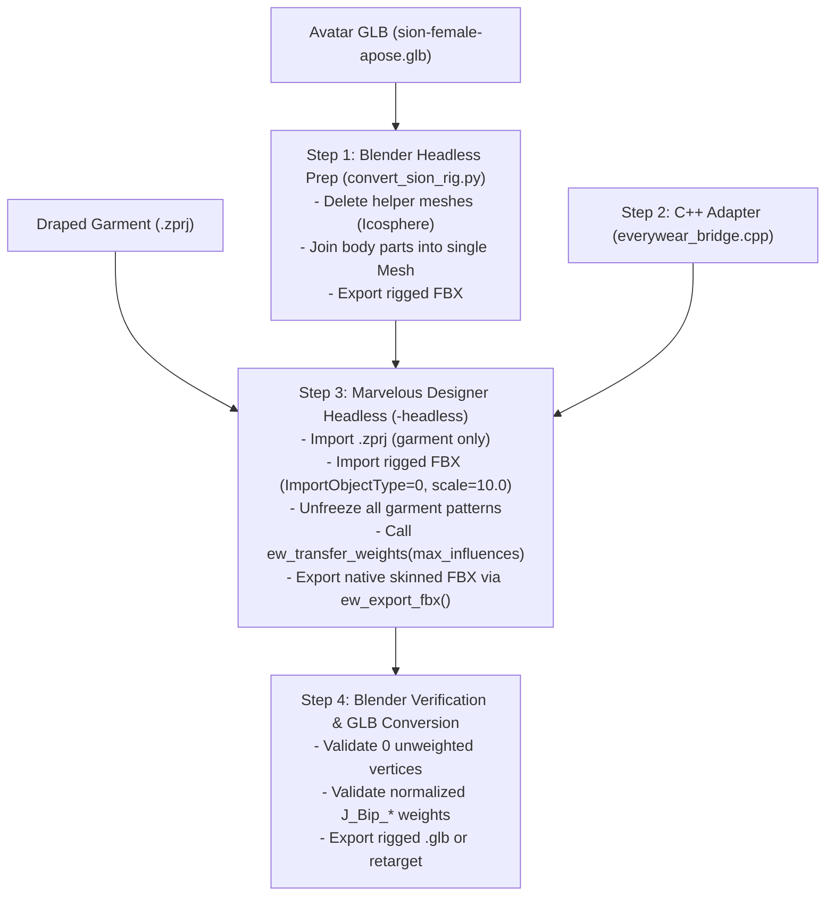

# Marvelous Designer Python API: Developer & Agent Reference Manual

This document is a technical reference manual for automating pattern creation, seamline stitching, and garment draping in Marvelous Designer / CLO3D via Python.

---

## 1. System Architecture & Module Overview

Marvelous Designer exposes its internal CAD/simulation engine to Python through embedded C++ bindings (compiled via `pybind11`). When running inside Marvelous Designer's Python environment, five primary modules are directly importable:

```python
import pattern_api  # 2D pattern geometry, lines, annotations, and seam stitching
import utility_api  # 3D viewport, simulation control, camera, and environment
import import_api   # File and asset importing (OBJ, FBX, ZPRJ, Avatars)
import export_api   # File exporting (OBJ, FBX, Alembic, ZPRJ, ZPAC, renders)
import fabric_api   # Material properties, fabric physical presets, and textures
```

---

## 2. Geometry Engine: Coordinates, Scale & Points

### 2.1 Units & Coordinate System
- **2D Pattern Window Units:** **Millimeters (mm)**.
- **Human Measurement Data (Scans/YAML):** Almost always in **centimeters (cm)** or **meters (m)**.
- **Conversion Invariant:** You **must** scale centimeter values by `10.0` before passing them to the API:
  ```python
  SCALE = 10.0  # 1 cm = 10 mm in MD
  ```
- **Origin & Axes:** $(0, 0)$ is the 2D world origin. $+X$ extends to the right; $+Y$ extends upwards.

### 2.2 Vertex Specification Schema
Each vertex in a pattern boundary is a 3-tuple:
```python
(x: float, y: float, point_type: int)
```

| `point_type` | Type | Behavior |
| :---: | :--- | :--- |
| `0` | **Corner Point** | Standard boundary vertex. Ends the previous edge and begins a new distinct sewing segment. |
| `1` | **Curve Point** | Curvature control point along an edge. Modifies edge geometry **without** splitting the segment into multiple sewing edges. |

Vertices must form a continuous, non-self-intersecting closed polygon in either counter-clockwise or clockwise order.

---

## 3. Pattern Generation API

### Installed-build correction (verified 2026-10-18)

In the current local MD build, `CreatePatternWithPoints` **discards type-1
intermediate points**. A 100 × 100 mm square with a type-1 point at (50, -10)
still reports four straight lines and area 10,000 mm² through
`GetPatternLineInfo` / `GetPatternPieceArea`. The older type-1 guidance below
must not be used to preserve GarmentCode curves in this build.

`sion_pipeline/drape_marvelous.py` instead samples curves at equal arc-length
fractions into explicit type-0 segments, retains an original-edge → MD-segments
map, and sews every paired subsegment in reverse order. It checks MD's actual
line count before sewing. `SetPatternPieceName` preserves panel identities in
exported OBJ groups.

`SetArrangementPosition(pid, x, y, z)` sets **percentage offsets**, not world
coordinates or a rotation. Native arrangement centers each half-panel
independently; matching both halves to one center point overlaps them. On the
Sion female body, front left/right use X=35/65, back left/right X=15/85;
their Y percentage is calculated from the drafted panel height. Explicit
placement avoids cross-body sewing and cloth starting at face height. The neck cylinder
uses a different origin: `Neck_Front` defaults to X=0, `Neck_Back` to X=50.
For quarter-band collars, use front left/right X=87/13 and back left/right
X=62/38; copying torso offsets wraps the front collar through the neck.

### 3.1 `pattern_api.CreatePatternWithPoints`
Constructs a new 2D pattern piece in the 2D editor window.

```python
pattern_id = pattern_api.CreatePatternWithPoints(points: list[tuple[float, float, int]]) -> int
```

- **Parameters:**
  - `points`: Ordered list of `(x, y, point_type)` tuples defining the closed outer perimeter.
- **Return Value:**
  - An integer representing the **Pattern ID** (0-indexed in the order created: `0, 1, 2, ...`).
  - Keep this return value; it is required for all sewing, layer, and arrangement operations.

### 3.2 `pattern_api.CreateInternalShapeWithPoints`
Adds internal cut lines or folding lines inside an existing pattern piece.

```python
internal_id = pattern_api.CreateInternalShapeWithPoints(
    pattern_id: int,
    points: list[tuple[float, float, int]],
    is_closed: bool
) -> int
```

---

## 4. Sewing & Stitching API (`AddSeamlinePairGroup`)

### 4.1 Internal Nomenclature
In the user interface, connections are called **"Sewing"** or **"Stitches"**. In the internal C++ engine (`libCloScene.dylib`), seams are structured as **`SeamLinePair`** objects held inside **`SeamLinePairGroup`** containers. 

### 4.2 Function Signatures & Overloads

```python
success = pattern_api.AddSeamlinePairGroup(
    pattern1_id: int,
    segment1_idx: int,
    pattern2_id: int,
    segment2_idx: int,
    reverse: bool,
    is_fold: bool
) -> bool
```

| Parameter | Type | Description |
| :--- | :---: | :--- |
| `pattern1_id` | `int` | Integer ID of the first pattern piece (from `CreatePatternWithPoints`). |
| `segment1_idx` | `int` | 0-indexed edge segment on `pattern1`. |
| `pattern2_id` | `int` | Integer ID of the second pattern piece. |
| `segment2_idx` | `int` | 0-indexed edge segment on `pattern2`. |
| `reverse` | `bool` | `False` = parallel stitch direction; `True` = opposite/inverted direction. Prevents seam twisting. |
| `is_fold` | `bool` | `False` for standard seams; `True` for pleats or folded seam allowances. |

#### Additional Overloads (Internal Lines):
- `AddSeamlinePairGroup(pattern1, internal_shape1, line1, pattern2, line2, reverse, is_fold)`: Outer pattern to internal line.
- `AddSeamlinePairGroup(pattern1, internal_shape1, line1, pattern2, internal_shape2, line2, reverse, is_fold)`: Internal line to internal line.

---

## 5. Segment Indexing & Alignment Rules

### 5.1 The 0-Indexed Edge Rule
On a pattern created with $N$ vertices $[P_0, P_1, P_2, \dots, P_{N-1}]$:
- **Segment 0** spans from $P_0 \to P_1$
- **Segment 1** spans from $P_1 \to P_2$
- **Segment $k$** spans from $P_k \to P_{k+1}$
- **Segment $N-1$** spans from $P_{N-1} \to P_0$ (closing the polygon)

```
        P4 (Shoulder Tip)
         /\
Seg 3   /  \  Seg 4 (Shoulder Seam)
(Arm)  /    \
      P3     P5 (Neck)
      |       \
Seg 2 |        \ Seg 5 (Neckline)
(Side)|         \
      P2         P6 (Center Front)
```

### 5.2 The Discrete Landmark Pattern Design Rule
> [!IMPORTANT]
> Define pattern perimeters using **discrete corner points (`point_type=0`) at true structural seam boundaries** (Hem, Waist, Underarm, Shoulder Tip, Neck Point).
> 
> If an edge is approximated with 10 intermediate points using `point_type=0`, Marvelous Designer creates 10 separate segment indices for that edge. Standard segment sewing will only sew 1 of those 10 micro-segments. Use `point_type=1` for curvature points, or keep discrete segments and curve via MD's Curvature tool.

### 5.3 How Stitching & Edge Reversal Work (`reverse`)

The native sewing command is:
```python
pattern_api.AddSeamlinePairGroup(
    pattern1, seg1, pattern2, seg2, reverse, is_fold
)
```

To get stitching 100% right on the first attempt without guessing or trial-and-error, understand the **vector direction model**:

#### 1. The Segment Vector Direction
Every segment $S$ is a directed vector from its start vertex to its end vertex:
$$\vec{S} = P_{\text{start}} \longrightarrow P_{\text{end}}$$
- **Normal Seam (`reverse=False`):** Connects start-to-start and end-to-end:
  $$\vec{S}_1^{\text{start}} \longleftrightarrow \vec{S}_2^{\text{start}} \quad \text{and} \quad \vec{S}_1^{\text{end}} \longleftrightarrow \vec{S}_2^{\text{end}}$$
- **Reversed Seam (`reverse=True`):** Connects start-to-end and end-to-start:
  $$\vec{S}_1^{\text{start}} \longleftrightarrow \vec{S}_2^{\text{end}} \quad \text{and} \quad \vec{S}_1^{\text{end}} \longleftrightarrow \vec{S}_2^{\text{start}}$$

#### 2. The Universal Mathematical Law of `reverse`
To connect two edges into a parallel seam without an "X" criss-cross Mobius twist:
- **Use `reverse=False`** if both edges in 3D run in the **same anatomical direction** (e.g. both run from Shoulder Tip $\to$ Underarm).
- **Use `reverse=True`** if the two edges in 3D run in **opposite anatomical directions** (e.g. Edge A runs Hem $\to$ Waist, while Edge B runs Waist $\to$ Hem).

$$\text{Criss-cross occurs if and only if opposite directional vectors are sewn with } \text{reverse=False}.$$

#### 3. The Three Golden Invariants (One-Shot Checklist)

1. **Self-Closing Cylinders (Sleeve Tubes, Collar Rings, Pant Inseams):**
   - **ALWAYS `reverse=True`**.
   - On any single closed polygon, clockwise perimeter traversal goes **bottom-to-top** on the right side and **top-to-bottom** on the opposite left side. They are intrinsically opposite vectors. If you pass `reverse=False`, the tube twists into an "X" Mobius strip.

2. **Front-to-Back Torso Seams (Shoulders & Side Seams with 2D Reflected Back):**
   - In 2D, the Back Bodice is drafted and horizontally reflected ($X' = 2 \cdot cx - X$), inverting its winding order to counter-clockwise.
   - When arranged on `Body_Back_Center_1`, its normal faces outward and its segment indices match Front 1-to-1 ($k \longleftrightarrow k$).
   - Both Front and Back segment vectors travel in the same 3D direction $\implies$ **Use `reverse=False`**!
   - This connects bottom-to-bottom (Hem-to-Hem, Waist-to-Waist) and top-to-top (Tip-to-Tip, Neck-to-Neck) without diagonal "X" criss-crossing.

3. **Sleeve-to-Armhole Cap Curves:**
   - Both sleeve cap and bodice armhole vectors travel Crown $\to$ Underarm $\implies$ **Use `reverse=False`**!

---

## 6. Common Garment Seam Topologies

### 6.1 Standard Bodice (T-Shirt / Top)
Vertices are defined starting at Bottom-Left Hem going clockwise:

```
           [P5] Neck R --- [P6] Center Neck --- [P7] Neck L
          /                                              \
   [P4] Sh-Tip R                                     [P8] Sh-Tip L
      \                                                 /
   Seg 3 (Armhole R)                              Seg 8 (Armhole L)
        \                                             /
      [P3] Underarm R                           [P9] Underarm L
        |                                             |
   Seg 2 (Upper Side)                            Seg 9 (Upper Side)
        |                                             |
      [P2] Waist R                              [P10] Waist L
        |                                             |
   Seg 1 (Lower Side)                            Seg 10 (Lower Side)
        |                                             |
      [P1] Hem R ----------- Seg 0 (Hem) ---------- [P0] Hem L
```

#### Seam Mapping Matrix (With Reflected Back Bodice):
| Seam Target | Front Seg | Back Seg | `reverse` | Direction Pairing |
| :--- | :---: | :---: | :---: | :--- |
| **Right Shoulder** | `4` | `4` | `False` | Tip-to-Tip, Neck-to-Neck |
| **Left Shoulder** | `7` | `7` | `False` | Neck-to-Neck, Tip-to-Tip |
| **Right Lower Side** | `1` | `1` | `False` | Hem-to-Hem, Waist-to-Waist |
| **Right Upper Side** | `2` | `2` | `False` | Waist-to-Waist, Underarm-to-Underarm |
| **Left Upper Side** | `9` | `9` | `False` | Underarm-to-Underarm, Waist-to-Waist |
| **Left Lower Side** | `10` | `10` | `False` | Waist-to-Waist, Hem-to-Hem |

> [!IMPORTANT]
> **The Back Bodice 2D Reflection Rule:**
> In 2D, draft the Back Bodice matching Front Bodice segment order, then horizontally reflect it:
> `back_pts = [(round(2 * cx_b * scale - x, 3), y, z) for (x, y, z) in raw_back_pts]`
> This inverts the winding order to CCW and reflects $X$, perfectly pairing segment $k$ on Front to segment $k$ on Back with `reverse=False`.

### 6.2 Set-in Sleeve Topology
A sleeve is defined with 5 key vertices:
- $P_0$: Cuff Hem Left
- $P_1$: Cuff Hem Right $\rightarrow$ **Seg 0: Cuff Hem**
- $P_2$: Underarm Right $\rightarrow$ **Seg 1: Underarm Seam Right**
- $P_3$: Crown Apex $\rightarrow$ **Seg 2: Cap Curve Right**
- $P_4$: Underarm Left $\rightarrow$ **Seg 3: Cap Curve Left**
- Loop closure $P_4 \to P_0 \rightarrow$ **Seg 4: Underarm Seam Left**

#### Seam Mapping Matrix:
| Target Seam | Piece A | Piece B | Recommended `reverse` | Explanation |
| :--- | :---: | :---: | :---: | :--- |
| **Sleeve Tube Closure** | Sleeve `seg 1` | Sleeve `seg 4` | **`True`** | Opposing perimeter edges $\implies$ clean cylinder |
| **Left Armhole (Front)** | Left Sleeve `seg 3` | Front Bodice `seg 8` | **`False`** | Crown-to-Tip, Underarm-to-Underarm |
| **Left Armhole (Back)** | Left Sleeve `seg 2` | Back Bodice `seg 8` | **`False`** | Crown-to-Tip, Underarm-to-Underarm |
| **Right Armhole (Front)** | Right Sleeve `seg 2` | Front Bodice `seg 3` | **`False`** | Crown-to-Tip, Underarm-to-Underarm |
| **Right Armhole (Back)** | Right Sleeve `seg 3` | Back Bodice `seg 3` | **`False`** | Crown-to-Tip, Underarm-to-Underarm |

> [!IMPORTANT]
> **The Self-Closing Cylinder Rule (Sleeve Tubes & Collar Rings):**
> On any single 2D polygon piece, the perimeter is traced in a continuous loop:
> - The right-hand edge (`seg 1`) goes **bottom-to-top** ($P_{cuff} \to P_{underarm}$).
> - The opposite left-hand edge (`seg 4`) continues around the loop and goes **top-to-bottom** ($P_{underarm} \to P_{cuff}$).
> - If `reverse=False`, the seam connects $P_{cuff} \to P_{underarm}$, creating a diagonal **Mobius twist / criss-cross**!
> - **`reverse=True` must always be used** when sewing opposite edges of the same pattern piece into a cylinder (Sleeve Tubes, Collar Rings, Skirt Side Tubes).

---

## 7. 2D and 3D Anatomical Positioning & Coordinate Coupling

### 7.1 The 2D-to-3D Coordinate Coupling Rule
In Marvelous Designer, pattern coordinates in the 2D Pattern Window are directly coupled to initial 3D viewport placement:
1. **$Y = 0$ is the Floor:** The avatar stands with its feet at $Y = 0$.
2. **$X = 0$ is the Avatar Center:** The avatar's spine and vertical symmetry axis sit at $X = 0$.
3. **3D Height Matches 2D $Y$ Height:** When `CreatePatternWithPoints` spawns a pattern, its initial 3D vertical elevation ($Z$ or $Y$ in 3D depending on coordinate convention) directly equals its 2D $Y$ coordinate.
4. **The "Clothes at Feet" Trap:** If a pattern is drafted with its bottom hem at $Y = 0$, the garment spawns on the floor around the avatar's ankles in 3D.
5. **The Anatomical Offset Formula:**
   Always offset the bottom hem to the avatar's actual anatomical hip level:
   $$Y_{hem} = Y_{neck} - \text{shirt\_length} \approx 902\text{ mm} \quad (\text{for a 152 cm avatar})$$

### 7.2 Anatomical 2D Layout Map
- **Front Bodice:** Centered at $X = 0$, spanning $Y \in [902, 1250]\text{ mm}$ (lands directly over the avatar's torso silhouette).
- **Back Bodice:** Placed at $X \approx +550\text{ mm}$, spanning $Y \in [902, 1250]\text{ mm}$ (beside the torso at identical height).
- **Left Sleeve:** Placed at $X \approx -500\text{ mm}$, $Y \in [1000, 1245]\text{ mm}$ (next to the left arm).
- **Right Sleeve:** Placed at $X \approx +1050\text{ mm}$, $Y \in [1000, 1245]\text{ mm}$ (next to the right arm).
- **Collar:** Centered at $X = 0$, placed directly above the neck at $Y \approx 1330\text{ mm}$.

### 7.3 3D Arrangement & Draping Workflow
1. **Automated 3D Native Arrangement:**
   - Query the avatar's native arrangement points via `pattern_api.GetArrangementList()`.
   - Each entry in `GetArrangementList()` is a dictionary with:
     - `"ArrangementIndex"`: integer ID as string (e.g. `"0"`)
     - `"ArrangementName"`: body part name (e.g. `"Body_Front"`, `"Body_Back"`, `"Arm_Front_1_L"`, `"Arm_Front_1_R"`, `"Neck_Front"`)
     - `"ArrangementType"`: `"Curved"` or `"Flat"`

> [!WARNING]
> **The Arrangement Name Substring Collision Trap:**
> In Marvelous Designer, arm arrangement points are named `Arm_Front_1_L`, `Arm_Front_1_R`, `Arm_Back_1_L`, `Arm_Back_1_R`.
> If you perform a naive substring search for `"front"` or `"back"`, **the front and back bodice pieces will match the arms and wrap around the biceps!**
> 
> You **must** enforce strict exclusions:
> - **Front / Back Bodice:** Must strictly **exclude** `["arm", "leg", "pocket", "collar", "neck"]` and prioritize `["body_front", "front body", "chest", "body_back", "back body"]`.
> - **Sleeves:** Must require `["arm"]` and strictly separate Left (`["l", "left"]`, exclude `["r", "right"]`) from Right (`["r", "right"]`, exclude `["l", "left"]`).

   ```python
   def match_arrangement_point(arr_list, priority_patterns, forbidden=None):
       for pattern in priority_patterns:
           for item in arr_list:
               name = item.get("ArrangementName", "").lower()
               if forbidden and any(f.lower() in name for f in forbidden): continue
               if all(k.lower() in name for k in pattern):
                   return int(item["ArrangementIndex"])
       return None

   arr_list = pattern_api.GetArrangementList()
   if arr_list:
       # Front Bodice: strictly forbid 'arm'
       f_idx = match_arrangement_point(arr_list, [["body_front"], ["front", "body"], ["chest"]], forbidden=["arm", "leg"])
       # Back Bodice: strictly forbid 'arm'
       b_idx = match_arrangement_point(arr_list, [["body_back"], ["back", "body"], ["back_torso"]], forbidden=["arm", "leg"])
       # Left Sleeve: require 'arm' and 'l', forbid 'r'
       l_idx = match_arrangement_point(arr_list, [["arm", "front", "l"], ["arm", "_l"], ["arm", "left"]], forbidden=["_r", "right"])
       # Right Sleeve: require 'arm' and 'r', forbid 'l'
       r_idx = match_arrangement_point(arr_list, [["arm", "front", "r"], ["arm", "_r"], ["arm", "right"]], forbidden=["_l", "left"])
       # Neckband: require 'neck' or 'collar', forbid 'arm'
       n_idx = match_arrangement_point(arr_list, [["neck", "front"], ["neck"], ["collar"]], forbidden=["arm", "leg", "body"])

       pattern_api.SetArrangement(front_id, f_idx)
       pattern_api.SetArrangement(back_id, b_idx)
       pattern_api.SetArrangement(left_sleeve_id, l_idx)
       pattern_api.SetArrangement(right_sleeve_id, r_idx)
       pattern_api.SetArrangement(neckband_id, n_idx)

       utility_api.ResetClothArrangement() # Wraps all 5 pieces around the 3D avatar!
   ```
2. **Custom Avatars (Manual 3D Gizmo):**
   - If the avatar lacks arrangement bounding volumes:
   - Select the Back panel in the 3D window (`Q`).
   - Drag the blue Z-axis gizmo arrow backwards to slide the back panel behind the avatar.
   - Right-click the back panel $\to$ **Flip Normal** (or **Horizontal Flip**) so the outside fabric faces outward.
   - Press **Spacebar** to simulate; the stitches pull the panels closed into a fitted 3D garment.

### 7.4 Complete Blue Dot Catalog (Marvelous Designer Standard Preset)
Every native arrangement point defined in `Adult_V2_Arrangement_Point.arr`:

| Body Region | Standard Blue Dot Name | Typical Garment Piece |
| :--- | :--- | :--- |
| **Chest (Upper)** | `Body_Front_Center_1` | Front Bodice (T-Shirt, Shirt, Jacket) |
| **Chest (Mid)** | `Body_Front_Center_2` | Front Bodice (Tunic, Dress) |
| **Solar Plexus** | `Body_Front_Center_3` | Waistcoat, Corset |
| **Front Waist** | `Body_Front_Waist` | Belt, Waistband |
| **Front Pelvis** | `Body_Front_Center_5` | Pants Front, Skirt Front |
| **Upper Back** | `Body_Back_Center_1` | Back Bodice (T-Shirt, Shirt, Jacket) |
| **Mid Back** | `Body_Back_Center_2` | Back Bodice (Dress) |
| **Lower Mid Back**| `Body_Back_Center_3` | Corset Back |
| **Back Waist** | `Body_Back_Waist` | Back Waistband |
| **Back Pelvis** | `Body_Back_Center_5` | Pants Back, Skirt Back |
| **Left Bicep (Outer)** | `Arm_Outside_1_L` | Left Short Sleeve / Cap Sleeve |
| **Right Bicep (Outer)**| `Arm_Outside_1_R` | Right Short Sleeve / Cap Sleeve |
| **Left Arm (Mid)** | `Arm_Outside_2_L` | Left 3/4 Sleeve |
| **Right Arm (Mid)**| `Arm_Outside_2_R` | Right 3/4 Sleeve |
| **Left Forearm** | `Arm_Outside_3_L` | Left Full Sleeve Cuff |
| **Right Forearm**| `Arm_Outside_3_R` | Right Full Sleeve Cuff |
| **Neck (Front)** | `Neck_Front` | Crewneck Collar, Mandarin Collar |
| **Collar Ring** | `Neck_Collar` | Shirt Collar, Turtleneck |
| **Neck (Back)** | `Neck_Back` | Back Collar, Hood Base |
| **Shoulder (L / R)** | `Shoulder_L` / `Shoulder_R` | Epaulettes, Shoulder Pads |
| **Thighs** | `Leg_Front_L` / `Leg_Front_R` | Shorts, Trousers Upper |
| **Calves** | `Leg_Calf_Front_L` / `Leg_Calf_Front_R`| Trousers Lower |
| **Skirts** | `Leg_Skirt_Front` / `Leg_Skirt_Back` | A-Line / Circular Skirts |

---

## 8. Simulation & Draping Automation

To trigger cloth physics and drape the pre-stitched garment:

```python
# Start simulation
utility_api.Simulate(True)

# Stop simulation
utility_api.Simulate(False)
```

---

## 9. Introspection & Verification API

```python
# Returns JSON string containing all stitches and properties in the project
stitch_json = pattern_api.GetAllStitchProperty()

# Get total number of patterns currently created
count = pattern_api.GetPatternCount()

# Retrieve list of stitch groups connected to a specific pattern
seam_list = pattern_api.GetSeamlinePairGroupListInPattern(pattern_id)

# Query avatar arrangement points
arr_list = pattern_api.GetArrangementList()
```

---

## 10. Complete Canonical Production Boilerplate

The complete, verified production script creating a 5-piece, anatomically positioned, fully-stitched garment:

```python
import pattern_api
import utility_api
import math

scale = 10.0  # 1 cm = 10 mm in MD

def pt(x, y):
    return (round(x * scale, 3), round(y * scale, 3), 0)

# 1. Avatar Anatomical Landmark Heights (cm -> mm)
neck_y = 125.0       # 1250 mm: Neck point
sh_tip_y = 122.5     # 1225 mm: Shoulder tip
armscye_y = 109.0    # 1090 mm: Underarm level
waist_y = 100.0      # 1000 mm: Natural waist
hem_y = 90.2         # 902 mm: Bottom hem
front_scoop_y = 118.2 # 1182 mm: Front neck scoop
back_scoop_y = 123.2  # 1232 mm: Back neck scoop

# Widths & Design Ease (cm)
bust_w = 18.3; waist_w = 13.5; hem_w = 17.0; sh_w = 15.5; neck_w = 6.0

# 2. Front Bodice (Centered on Avatar Torso: X = 0)
cx_front = 0.0
front_pts = [
    pt(cx_front - hem_w, hem_y),       # 0: Hem Left
    pt(cx_front + hem_w, hem_y),       # 1: Hem Right      (Seg 0: Hem)
    pt(cx_front + waist_w, waist_y),    # 2: Waist Right    (Seg 1: Lower Side R)
    pt(cx_front + bust_w, armscye_y),  # 3: Underarm Right (Seg 2: Upper Side R)
    pt(cx_front + sh_w, sh_tip_y),     # 4: Sh-Tip Right   (Seg 3: Armhole R)
    pt(cx_front + neck_w, neck_y),     # 5: Neck Right     (Seg 4: Shoulder R)
    pt(cx_front, front_scoop_y),       # 6: Center Scoop   (Seg 5: Neck R)
    pt(cx_front - neck_w, neck_y),     # 7: Neck Left      (Seg 6: Neck L)
    pt(cx_front - sh_w, sh_tip_y),     # 8: Sh-Tip Left    (Seg 7: Shoulder L)
    pt(cx_front - bust_w, armscye_y),  # 9: Underarm Left  (Seg 8: Armhole L)
    pt(cx_front - waist_w, waist_y),   # 10: Waist Left    (Seg 9: Upper Side L)
]
front_id = pattern_api.CreatePatternWithPoints(front_pts)

# 3. Back Bodice (Beside Avatar: X = 550 mm)
cx_back = 55.0
back_pts = [
    pt(cx_back - hem_w, hem_y),        # 0
    pt(cx_back + hem_w, hem_y),        # 1
    pt(cx_back + waist_w, waist_y),    # 2
    pt(cx_back + bust_w, armscye_y),   # 3
    pt(cx_back + sh_w, sh_tip_y),      # 4
    pt(cx_back + neck_w, neck_y),      # 5
    pt(cx_back, back_scoop_y),         # 6: Shallow back neck
    pt(cx_back - neck_w, neck_y),      # 7
    pt(cx_back - sh_w, sh_tip_y),      # 8
    pt(cx_back - bust_w, armscye_y),   # 9
    pt(cx_back - waist_w, waist_y),    # 10
]
back_id = pattern_api.CreatePatternWithPoints(back_pts)

# 4. Sleeves (Left: X = -500 mm, Right: X = +1050 mm)
bicep_w = 12.5; cuff_w = 11.0; sleeve_len = 14.0; cap_h = 10.5; s_base = 100.0

cx_ls = -50.0
left_sleeve_pts = [
    pt(cx_ls - cuff_w, s_base),
    pt(cx_ls + cuff_w, s_base),
    pt(cx_ls + bicep_w, s_base + sleeve_len),
    pt(cx_ls, s_base + sleeve_len + cap_h),
    pt(cx_ls - bicep_w, s_base + sleeve_len),
]
left_sleeve_id = pattern_api.CreatePatternWithPoints(left_sleeve_pts)

cx_rs = 105.0
right_sleeve_pts = [
    pt(cx_rs - cuff_w, s_base),
    pt(cx_rs + cuff_w, s_base),
    pt(cx_rs + bicep_w, s_base + sleeve_len),
    pt(cx_rs, s_base + sleeve_len + cap_h),
    pt(cx_rs - bicep_w, s_base + sleeve_len),
]
right_sleeve_id = pattern_api.CreatePatternWithPoints(right_sleeve_pts)

# 5. Neckband Collar (Above Neck: Y = 1330 mm)
collar_y = 133.0; neck_len = 34.0; neck_h = 2.5
neckband_pts = [
    pt(-neck_len / 2.0, collar_y),
    pt(neck_len / 2.0, collar_y),
    pt(neck_len / 2.0, collar_y + neck_h),
    pt(-neck_len / 2.0, collar_y + neck_h),
]
neckband_id = pattern_api.CreatePatternWithPoints(neckband_pts)

# 6. Execute 13 Stitches
def sew(p1, s1, p2, s2, rev=False):
    pattern_api.AddSeamlinePairGroup(int(p1), int(s1), int(p2), int(s2), bool(rev), False)

sew(front_id, 4, back_id, 7, rev=True)   # Right Shoulder (Front R <--> Back R)
sew(front_id, 7, back_id, 4, rev=True)   # Left Shoulder (Front L <--> Back L)
sew(front_id, 1, back_id, 10, rev=True)  # Right Lower Side (Hem->Waist)
sew(front_id, 2, back_id, 9, rev=True)   # Right Upper Side (Waist->Arm)
sew(front_id, 9, back_id, 2, rev=True)   # Left Upper Side (Arm->Waist)
sew(front_id, 10, back_id, 1, rev=True)  # Left Lower Side (Waist->Hem)
sew(left_sleeve_id, 1, left_sleeve_id, 4, rev=True)   # Left Sleeve Tube (Cuff<->Cuff)
sew(right_sleeve_id, 1, right_sleeve_id, 4, rev=True) # Right Sleeve Tube (Cuff<->Cuff)
sew(left_sleeve_id, 3, front_id, 3, rev=True)   # Left Armhole Front (Crown-to-Tip)
sew(left_sleeve_id, 2, back_id, 8, rev=True)   # Left Armhole Back (Crown-to-Tip)
sew(right_sleeve_id, 2, front_id, 8, rev=True)  # Right Armhole Front (Crown-to-Tip)
sew(right_sleeve_id, 3, back_id, 3, rev=True)  # Right Armhole Back (Crown-to-Tip)
sew(neckband_id, 1, neckband_id, 3, rev=True)   # Neckband Ring (Bottom<->Bottom)

# 7. Automated 3D Arrangement (Strict Matching)
def match_arrangement_point(arr_list, priority_patterns, forbidden=None):
    for pattern in priority_patterns:
        for item in arr_list:
            name = item.get("ArrangementName", "").lower()
            if forbidden and any(f.lower() in name for f in forbidden): continue
            if all(k.lower() in name for k in pattern):
                return int(item["ArrangementIndex"])
    return None

arr_list = pattern_api.GetArrangementList()
if arr_list:
    f_idx = match_arrangement_point(arr_list, [["body_front"], ["front", "body"], ["chest"]], forbidden=["arm", "leg"])
    b_idx = match_arrangement_point(arr_list, [["body_back"], ["back", "body"], ["back_torso"]], forbidden=["arm", "leg"])
    l_idx = match_arrangement_point(arr_list, [["arm", "front", "l"], ["arm", "_l"], ["arm", "left"]], forbidden=["_r", "right"])
    r_idx = match_arrangement_point(arr_list, [["arm", "front", "r"], ["arm", "_r"], ["arm", "right"]], forbidden=["_l", "left"])
    n_idx = match_arrangement_point(arr_list, [["neck", "front"], ["neck"], ["collar"]], forbidden=["arm", "leg", "body"])

    pattern_api.SetArrangement(front_id, f_idx)
    pattern_api.SetArrangement(back_id, b_idx)
    pattern_api.SetArrangement(left_sleeve_id, l_idx)
    pattern_api.SetArrangement(right_sleeve_id, r_idx)
    pattern_api.SetArrangement(neckband_id, n_idx)
    utility_api.ResetClothArrangement() # Wraps all 5 pieces around the 3D avatar!
```

---

## 11. Pants & Shorts Seam Topology Quick-Reference

For a standard 4-panel lower-body construction (`Front Left`, `Front Right`, `Back Left`, `Back Right`):

```python
# 1. Back Darts (Close dart V-notches)
pattern_api.AddSeamlinePairGroup(bl_id, dart_edge_a, bl_id, dart_edge_b, False, False)
pattern_api.AddSeamlinePairGroup(br_id, dart_edge_a, br_id, dart_edge_b, False, False)

# 2. Center Front Crotch Seam (Opposite vertical vectors require reverse=True)
pattern_api.AddSeamlinePairGroup(fl_id, fly_edge, fr_id, fly_edge, True, False)

# 3. Center Back Crotch Seam (Opposite vertical vectors require reverse=True)
pattern_api.AddSeamlinePairGroup(bl_id, rise_edge, br_id, rise_edge, True, False)

# 4. Outseams (Matching vertical vectors require reverse=False)
pattern_api.AddSeamlinePairGroup(fl_id, outseam_edge, bl_id, outseam_edge, False, False)
pattern_api.AddSeamlinePairGroup(fr_id, outseam_edge, br_id, outseam_edge, False, False)

# 5. Inseams (Matching vertical vectors require reverse=False)
pattern_api.AddSeamlinePairGroup(fl_id, inseam_edge, bl_id, inseam_edge, False, False)
pattern_api.AddSeamlinePairGroup(fr_id, inseam_edge, br_id, inseam_edge, False, False)
```

---

## 12. Headless Mode Execution & Non-Interactive Automation (`-headless`)

Marvelous Designer supports an automated headless execution mode that boots the engine offscreen (using offscreen OpenGL context), executes a Python script via its embedded Python 3.11 environment, and terminates cleanly without user intervention.

### 12.1 Headless CLI Invocation Pattern

The verified binary and invocation pattern on macOS:

```bash
/Applications/MarvelousDesigner.app/Contents/MacOS/MarvelousDesigner_PER \
  -headless /path/to/script.py \
  -headlesslog > /path/to/run.log 2>&1 &
```

- **CLI Options:**
  - `-headless <path>`: Specifies the Python file to execute. Marvelous Designer boots offscreen, sets up OpenGL, runs the script through `HeadlessApiController::ExecutePython`, and calls `ApplicationExit(1, 1)` upon completion.
  - `-headlesslog`: Directs engine logs to `<Assets>/Headless/headless_log.txt` and preserves terminal diagnostic output instead of muting to `/dev/null`.
- **Runtime Performance:** A typical procedural garment build (geometry creation, seam stitching, 50-step simulation, and OBJ/ZPRJ export) completes in **7 to 15 seconds**.

---

### 12.2 The Non-Interactive Export Invariant (CRITICAL)

> [!CAUTION]
> **The GUI Modal Dialog Trap in Headless Mode:**
> In interactive GUI mode, calling `export_api.ExportOBJ("out.obj")` or `export_api.ExportZPrj("out.zprj")` opens a Qt modal options dialog.
> 
> In **headless mode**, opening a modal dialog causes the process to hang indefinitely inside a nested `QEventLoop::exec` waiting for user clicks that will never arrive.
> 
> You **must** use the non-interactive overload signatures to suppress modal dialogs.

#### 1. Non-Interactive OBJ Export
Pass an `ApiTypes.ImportExportOption` instance as the second parameter. The internal engine detects the options struct and automatically sets `bShowDialog = False`:

```python
import ApiTypes
import export_api

opt = ApiTypes.ImportExportOption()
opt.bExportGarment = True
# Passing 'opt' forces non-interactive export (bShowDialog = False)
exported_files = export_api.ExportOBJ("/path/to/output.obj", opt)
# Returns list of generated files: ['/path/to/output.obj', '/path/to/output.mtl']
```

#### 2. Non-Interactive ZPRJ (Project) Export
Pass the boolean dialog suppression flag as `False`:

```python
# Signature: ExportZPrj(path: str, bShowDialog: bool) -> str
project_file = export_api.ExportZPrj("/path/to/output.zprj", False)
```

#### 3. Non-Interactive ZPAC (Garment) Export
Pass the boolean dialog suppression flag as `False`:

```python
# Signature: ExportZPac(path: str, bShowDialog: bool) -> str
garment_file = export_api.ExportZPac("/path/to/output.zpac", False)
```

---

### 12.3 Headless Simulation Stepping

In headless mode, run cloth simulation by specifying an integer frame count to `utility_api.Simulate`:

```python
import utility_api

# Simulate cloth settling for 50 steps synchronously
utility_api.Simulate(50)
```

- **Integer argument:** Dispatches `SimulationManager::Timer()` exactly $N$ times, advancing cloth physics frame by frame before synchronously returning control to Python.
- **Boolean argument:** Passing `True` enables continuous background simulation; passing `False` stops it. In headless scripts, prefer passing an explicit integer step count.

---

### 12.4 Headless Environment Invariants & Best Practices

1. **Internal pybind11 Bindings Only:**
   The modules `pattern_api`, `utility_api`, `export_api`, `import_api`, `fabric_api`, and `ApiTypes` exist only inside Marvelous Designer's embedded runtime. They cannot be imported from a standard virtual environment or system Python.
2. **Stdout & Stderr Redirection:**
   In headless mode, Python's standard output and error are captured into an in-memory `StringIO` buffer during script execution and dumped as a single batch `[Python]` log entry when the script terminates. For real-time progress logging, append directly to an external log file with `flush()`.
3. **Catch Internal Exceptions:**
   Any uncaught Python exception that escapes `run()` is converted by `pybind11` into a C++ `error_already_set` exception, unwinding the stack and preventing clean finalization. Always wrap headless execution logic in:
   ```python
   try:
       main()
   except Exception as e:
       import traceback
       traceback.print_exc()
   ```

---

### 12.5 Canonical Headless Production Boilerplate

A self-contained script ready for headless execution:

```python
import sys
import os
import traceback
import pattern_api
import utility_api
import export_api
import ApiTypes

def main():
    print("=== Marvelous Designer Headless Automation ===")
    
    # 1. Dimensions (mm)
    width = 500.0   # 50 cm
    height = 600.0  # 60 cm
    
    # 2. Create Front & Back Rectangular Panels
    front_pts = [(0.0, 0.0, 0), (width, 0.0, 0), (width, height, 0), (0.0, height, 0)]
    back_pts  = [(700.0, 0.0, 0), (700.0 + width, 0.0, 0), (700.0 + width, height, 0), (700.0, height, 0)]
    
    p_front = pattern_api.CreatePatternWithPoints(front_pts)
    p_back  = pattern_api.CreatePatternWithPoints(back_pts)
    
    # 3. Stitch Shoulder and Side Seams
    # Front Seg 2 (top) <--> Back Seg 2 (top)
    pattern_api.AddSeamlinePairGroup(p_front, 2, p_back, 2, False, False)
    # Front Seg 1 (right) <--> Back Seg 3 (left)
    pattern_api.AddSeamlinePairGroup(p_front, 1, p_back, 3, False, False)
    # Front Seg 3 (left) <--> Back Seg 1 (right)
    pattern_api.AddSeamlinePairGroup(p_front, 3, p_back, 1, False, False)
    
    # 4. Run Physics Simulation (50 steps)
    utility_api.Simulate(50)
    
    # 5. Non-Interactive OBJ Export
    export_opt = ApiTypes.ImportExportOption()
    export_opt.bExportGarment = True
    export_api.ExportOBJ("/tmp/shirt_headless.obj", export_opt)
    
    # 6. Non-Interactive ZPRJ Export
    export_api.ExportZPrj("/tmp/shirt_headless.zprj", False)
    
    print("=== Headless Script Completed Successfully ===")

if __name__ == "__main__":
    try:
        main()
    except Exception as e:
        traceback.print_exc()
        sys.exit(1)
```

---

### 12.6 Complete End-to-End Headless Pipeline: Avatar Loading, 3D Arrangement, Simulation & Blender Visualization

This section documents the end-to-end headless automation workflow verified in production (`create_shirt_headless.py` and `shirt_result.blend`), detailing how to load a 3D avatar, wrap 2D pattern panels around body arrangement points, simulate physical drape, export the finished garment, and visualize it millimeter-perfect alongside the avatar in Blender.

```
+---------------------------------------------------------------------------------------------------+
|                               Headless Automation Architecture                                   |
|                                                                                                   |
|  [Avatar OBJ / .avt]           [GarmentCode 2D CAD]                                               |
|           |                              |                                                        |
|  import_api.ImportFile()       pattern_api.CreatePatternWithPoints()                              |
|           |                              |                                                        |
|  Populates 109 Arrangement     pattern_api.AddSeamlinePairGroup()                                 |
|  Points Automatically                    |                                                        |
|           \                             /                                                         |
|            \                           /                                                          |
|             v                         v                                                           |
|             pattern_api.SetArrangement(pid, point_idx)                                            |
|             utility_api.ResetClothArrangement()  --> Wraps 2D panels into 3D around body          |
|                                       |                                                           |
|             utility_api.Simulate(100)           --> 100-step synchronous cloth drape simulation   |
|                                       |                                                           |
|             export_api.ExportOBJ(..., opt)      --> Non-interactive OBJ export (in mm)            |
|                                       |                                                           |
|             Blender: scale = 0.001              --> Millimeter-perfect character alignment        |
+---------------------------------------------------------------------------------------------------+
```

> **Which avatar:** garments for the Sion avatar builder are draped on `sion-female-apose.obj` or
> `sion-male-apose.obj` (millimetres, A-pose, facing +Z), in `REA-MARVELOUS/sion-avatars/` or
> `GarmentCode/sion_avatars/`. The README there has the steps to bring the garment into the builder.
> `new_base_female_a_pose.obj` below is the older 173 cm body that this section was first written with.

#### 1. Headless Avatar Loading (`import_api.ImportFile`)

Marvelous Designer headless mode can load avatar meshes without interactive file dialogs:

```python
import import_api

avatar_path = "/path/to/new_base_female_a_pose.obj"
success = import_api.ImportFile(avatar_path)
```

- **Supported Formats:** Works with standard Wavefront OBJ files (such as `new_base_female_a_pose.obj`) as well as native CLO/MD `.avt` avatar files.
- **Automatic Arrangement Point Population:** When the avatar is loaded into the headless scene, Marvelous Designer's internal avatar bounding volume generator automatically creates **109 native arrangement points** mapped to anatomical landmarks (chest, back, upper arms, forearms, waist, legs, neck).

#### 2. Querying Arrangement Points (`pattern_api.GetArrangementList`)

Query the registered arrangement points on the imported avatar:

```python
import pattern_api

arr_list = pattern_api.GetArrangementList()
print(f"Loaded {len(arr_list)} arrangement points")  # 109 points
```

Each entry in `arr_list` contains:
- `"ArrangementIndex"`: Unique integer ID (e.g. `"0"`, `"1"`, ...).
- `"ArrangementName"`: Anatomical identifier (e.g. `"Body_Front_Center_1"`, `"Body_Back_Center_1"`, `"Arm_Front_1_L"`, `"Arm_Back_1_L"`, `"Arm_Front_1_R"`, `"Arm_Back_1_R"`).
- `"ArrangementType"`: Arrangement surface type (`"Curved"` or `"Flat"`).

#### 3. Mapping 2D Panels to 3D Arrangement Points & 3D Wrapping

Assign each pattern piece to its corresponding arrangement target and trigger 3D wrapping:

```python
# 1. Map pattern IDs to arrangement point indices
ARRANGEMENT_TARGETS = {
    "left_ftorso":   "Body_Front_Center_1",
    "right_ftorso":  "Body_Front_Center_1",
    "left_btorso":   "Body_Back_Center_1",
    "right_btorso":  "Body_Back_Center_1",
    "left_sleeve_f": "Arm_Front_1_L",
    "left_sleeve_b": "Arm_Back_1_L",
    "right_sleeve_f": "Arm_Front_1_R",
    "right_sleeve_b": "Arm_Back_1_R",
}

for panel_name, target_dot in ARRANGEMENT_TARGETS.items():
    pid = panel_ids[panel_name]
    for item in arr_list:
        if item.get("ArrangementName", "").strip().lower() == target_dot.strip().lower():
            point_idx = int(item["ArrangementIndex"])
            pattern_api.SetArrangement(pid, point_idx)
            break

# 2. Wrap 2D panels into 3D positions around the avatar
utility_api.ResetClothArrangement()
```

- `pattern_api.SetArrangement(pid, point_idx)`: Associates the 2D pattern with the 3D arrangement cylinder/plane.
- `utility_api.ResetClothArrangement()`: Wraps the flat 2D pattern panels around the avatar body in 3D space, positioning them adjacent to their seam targets prior to physics simulation.

> [!IMPORTANT]
> **Back Panel Horizontal Mirror Invariant:** Remember that back arrangement points (`Body_Back_Center_1`, `Arm_Back_1_L/R`) face outward in reverse orientation. Any back panels (`btorso`, `sleeve_b`) must be horizontally reflected in 2D ($X' = cx - X$) prior to creation so seamlines connect straight without crossing through the body.

#### 4. Physics Drape Simulation (`utility_api.Simulate`)

Simulate the drape by stepping the solver synchronously:

```python
import utility_api

# Run 100 simulation steps to pull seamlines together and settle cloth onto avatar
utility_api.Simulate(100)
```

- 100 steps allow the internal spring solver to pull all 16 seamlines closed, resolve contact friction against the avatar mesh, and settle gravity drape without GUI overhead.

#### 5. Non-Interactive Export (`export_api.ExportOBJ` & `ExportZPrj`)

Export the final garment mesh non-interactively using `ApiTypes.ImportExportOption`:

```python
import ApiTypes
import export_api

opt = ApiTypes.ImportExportOption()
opt.bExportGarment = True
opt.bExportAvatar = False

# Non-interactive OBJ export (suppresses modal dialog)
export_api.ExportOBJ("/path/to/shirt_result.obj", opt)

# Non-interactive ZPRJ export
export_api.ExportZPrj("/path/to/shirt_result.zprj", False)
```

#### 6. Blender Visualization & Millimeter Scale Alignment

When visualizing the simulated garment in Blender alongside the character avatar:
- **Unit Scale Mismatch:** Marvelous Designer works in **millimeters (mm)**. The exported garment OBJ coordinates are in millimeters (e.g. `new_base_female` avatar height is $\approx 1738\text{ mm}$, and the shirt vertices range around $Y \in [1076, 1460]\text{ mm}$).
- **Blender Coordinate System:** Blender defaults to **meters (m)** where $1.0\text{ BU} = 1.0\text{ m}$. Importing the OBJ directly into Blender without scaling makes the shirt 1000× larger (1738 meters tall).
- **Scale Factor `0.001`:** To align the garment with character assets in Blender:
  ```python
  import bpy

  # 1. Import Garment OBJ
  bpy.ops.wm.obj_import(filepath="/path/to/shirt_result.obj")
  garment_obj = bpy.context.selected_objects[0]

  # 2. Scale by 0.001 (mm -> meters)
  garment_obj.scale = (0.001, 0.001, 0.001)
  bpy.ops.object.transform_apply(location=False, rotation=False, scale=True)

  # Result: Garment aligns millimeter-perfect with the character mesh!
  ```

> [!CAUTION]
> **Avatar Collision Invariant: Strip MToon Inverted-Hull Outlines:**
> Many VRM/anime avatars (including `new_base_female`) export with secondary outline shells (`Body.001`, `Face.001`) textured with `MToon_Outline_*`. These meshes are **inverted hulls** whose face normals point *inwards*.
> When Marvelous Designer calculates cloth-avatar collisions, inward-pointing normals confuse raycasts and surface proximity tests, causing cloth to snag, penetrate, or shred upon contact.
> **Rule:** Always strip or delete inverted-hull outline meshes (keep only `Body` and `Face`) before passing the avatar OBJ to `import_api.ImportFile()`. A clean collision avatar file is provided at `avatar_apose_collision.obj`.

> [!IMPORTANT]
> **Blender Pose Mode Invariant (`pose_position = 'REST'`):**
> When opening rigged avatar blend files in Blender alongside simulated cloth, ensure the Armature is set to REST position:
> `bpy.data.objects['Armature'].data.pose_position = 'REST'`
> If the armature remains in `POSE` mode, any active bone rotations or pose offsets will deform the character away from the canonical rest A-pose that Marvelous Designer draped against, causing the body to punch through the garment mesh.

- **Verified Blend File:** This setup is captured in `research/shirt_result.blend`, where `shirt_result.obj` is aligned millimeter-perfect over `new_base_female_a_pose.obj`.

#### 7. Complete Headless Production Pipeline Script (`create_shirt_headless.py`)

Below is the complete, standalone headless script tested and verified in production:

```python
import sys
import os
import traceback
import import_api
import pattern_api
import utility_api
import export_api
import ApiTypes

def run():
    print("=== Starting Headless Marvelous Designer Garment Pipeline ===", flush=True)

    # 1. Import Avatar Mesh (OBJ or .avt)
    avatar_path = "/Users/vaz/Desktop/antigravity_apps/GarmentCode/new_base_female/new_base_female_a_pose.obj"
    print(f"Loading avatar: {avatar_path}", flush=True)
    success = import_api.ImportFile(avatar_path)
    print(f"[AVATAR] ImportFile result: {success}", flush=True)

    # Query automatically populated arrangement points (109 points)
    arr_list = pattern_api.GetArrangementList()
    arr_count = len(arr_list) if arr_list else 0
    print(f"[ARRANGEMENT] Found {arr_count} arrangement points on avatar.", flush=True)

    # 2. Define 8 2D Pattern Panels (GarmentCode A-Pose Tee)
    # Coordinates in mm; Back panels are horizontally mirrored (X' = cx - X)
    panels_def = {
        'left_sleeve_b': [
            (1100.0, 1340.264, 0), (1100.0, 1127.006, 0),
            (1206.93, 1127.006, 0), (1293.461, 1334.057, 0), (1293.498, 1340.264, 0)
        ],
        'left_sleeve_f': [
            (1100.0, 1340.264, 0), (906.502, 1340.264, 0),
            (993.07, 1127.006, 0), (1100.0, 1127.006, 0)
        ],
        'left_ftorso': [
            (0.0, 1076.487, 0), (207.9, 1076.487, 0), (207.9, 1275.285, 0),
            (86.422, 1444.421, 0), (85.0, 1450.485, 0), (67.4, 1457.632, 0), (0.0, 1344.181, 0)
        ],
        'left_btorso': [
            (600.0, 1076.842, 0), (600.0, 1408.042, 0), (532.6, 1457.632, 0),
            (515.0, 1450.485, 0), (410.475, 1275.285, 0), (410.475, 1076.842, 0)
        ],
        'right_btorso': [
            (600.0, 1076.842, 0), (789.525, 1076.842, 0), (789.525, 1275.285, 0),
            (685.0, 1450.485, 0), (667.4, 1457.632, 0), (600.0, 1408.042, 0)
        ],
        'right_sleeve_b': [
            (-600.0, 1340.264, 0), (-793.498, 1340.264, 0),
            (-793.461, 1334.057, 0), (-706.93, 1127.006, 0), (-600.0, 1127.006, 0)
        ],
        'right_sleeve_f': [
            (-600.0, 1340.264, 0), (-600.0, 1127.006, 0),
            (-493.07, 1127.006, 0), (-406.502, 1340.264, 0)
        ],
        'right_ftorso': [
            (0.0, 1076.487, 0), (0.0, 1344.181, 0), (-67.4, 1457.632, 0),
            (-85.0, 1450.485, 0), (-86.422, 1444.421, 0), (-207.9, 1275.285, 0), (-207.9, 1076.487, 0)
        ]
    }

    panel_ids = {}
    for name, pts in panels_def.items():
        pid = pattern_api.CreatePatternWithPoints(pts)
        panel_ids[name] = pid
        print(f"[PATTERN] Created {name:15} -> ID: {pid}", flush=True)

    # 3. Procedural Seamline Pairs (16 Stitches)
    def sew(p1_name, e1, p2_name, e2, rev=True):
        pattern_api.AddSeamlinePairGroup(
            int(panel_ids[p1_name]), int(e1),
            int(panel_ids[p2_name]), int(e2),
            bool(rev), False
        )

    sew('left_sleeve_f', 0, 'left_sleeve_b', 4, rev=True)
    sew('left_sleeve_f', 2, 'left_sleeve_b', 1, rev=True)
    sew('left_sleeve_f', 1, 'left_ftorso', 2, rev=True)
    sew('left_sleeve_b', 3, 'left_ftorso', 3, rev=False)
    sew('left_sleeve_b', 2, 'left_btorso', 3, rev=True)
    sew('left_ftorso', 4, 'left_btorso', 2, rev=True)
    sew('left_ftorso', 1, 'left_btorso', 4, rev=True)
    sew('right_sleeve_f', 3, 'right_sleeve_b', 0, rev=True)
    sew('right_sleeve_f', 1, 'right_sleeve_b', 3, rev=True)
    sew('right_sleeve_f', 2, 'right_ftorso', 4, rev=True)
    sew('right_sleeve_b', 1, 'right_ftorso', 3, rev=False)
    sew('right_sleeve_b', 2, 'right_btorso', 2, rev=True)
    sew('right_ftorso', 2, 'right_btorso', 3, rev=True)
    sew('right_ftorso', 5, 'right_btorso', 1, rev=True)
    sew('right_ftorso', 0, 'left_ftorso', 6, rev=True)
    sew('right_btorso', 5, 'left_btorso', 0, rev=True)

    # 4. Map Panels to 3D Arrangement Points & Wrap
    ARRANGEMENT_TARGETS = {
        "left_ftorso": "Body_Front_Center_1",
        "right_ftorso": "Body_Front_Center_1",
        "left_btorso": "Body_Back_Center_1",
        "right_btorso": "Body_Back_Center_1",
        "left_sleeve_f": "Arm_Front_1_L",
        "left_sleeve_b": "Arm_Back_1_L",
        "right_sleeve_f": "Arm_Front_1_R",
        "right_sleeve_b": "Arm_Back_1_R"
    }

    if arr_list:
        for panel_name, target_dot in ARRANGEMENT_TARGETS.items():
            pid = panel_ids[panel_name]
            for item in arr_list:
                if item.get("ArrangementName", "").strip().lower() == target_dot.strip().lower():
                    pattern_api.SetArrangement(pid, int(item["ArrangementIndex"]))
                    break
        utility_api.ResetClothArrangement()
        print("[3D] Panels wrapped around avatar points.", flush=True)

    # 5. Physics Simulation (100 Steps)
    print("Simulating cloth drape (100 steps)...", flush=True)
    utility_api.Simulate(100)

    # 6. Non-Interactive Export
    out_obj = "/Users/vaz/Desktop/antigravity_apps/REA-MARVELOUS/research/shirt_result.obj"
    out_zprj = "/Users/vaz/Desktop/antigravity_apps/REA-MARVELOUS/research/shirt_result.zprj"
    opt = ApiTypes.ImportExportOption()
    opt.bExportGarment = True
    opt.bExportAvatar = False
    export_api.ExportOBJ(out_obj, opt)
    export_api.ExportZPrj(out_zprj, False)
    print("Pipeline completed successfully!", flush=True)

if __name__ == "__main__":
    try:
        run()
    except Exception as e:
        traceback.print_exc()
        sys.exit(1)
```

---

### 12.7 Headless EveryWear Auto-Rigging & Skinned FBX/GLB Export

Marvelous Designer includes **EveryWear**, a native engine for transferring avatar skeletal skin weights to simulated garments and exporting rigged, production-ready assets. In the interactive GUI, EveryWear is run via **CONNECT → EveryWear → Garment Tab**. In headless batch pipelines (such as automated garment generation with GarmentCode), EveryWear can be driven completely headlessly using an experimental C++ bridge adapter.



#### Why a Native C++ Bridge is Required

1. **No EveryWear Bindings in Embedded Python API:** Marvelous Designer's embedded Python modules (`pattern_api`, `utility_api`, `export_api`, `import_api`) expose methods for 2D CAD manipulation, physics drape stepping, arrangement points, and basic scene I/O. They expose **no Python bindings** for EveryWear weight transfer (`GarmentRiggingManager`) or metaverse export (`MetaverseConverter`).
2. **`export_api.ExportFBX()` Drops Garment Weights:** Calling the built-in `export_api.ExportFBX()` function strips all garment skin weights—even when native rigging data exists in the scene. The resulting cloth mesh in the FBX contains zero vertex groups.
3. **Native Engine Entry Points in `libCloScene.dylib`:** The core EveryWear weight transfer engine and skinned FBX exporter reside in `/Applications/MarvelousDesigner.app/Contents/Frameworks/libCloScene.dylib`:
   - `Marvelous::GarmentRiggingManager::Rigging`: Performs volumetric and barycentric skin-weight projection from avatar skin mesh to cloth vertices, followed by top-\(k\) influence pruning and normalization.
   - `Marvelous::GarmentRiggingManager::HasGarmentRiggingData`: Confirms that valid rigging data is registered on the active garment.
   - `Marvelous::MetaverseConverter::Export`: Exports the avatar skeleton, avatar skin, and fully skinned cloth mesh to an FBX container with intact vertex groups and bone weights.

To access these entry points in headless scripts without modifying application binaries or relying on external network/CONNECT services, a lightweight 57-line dynamic library adapter (`everywear_bridge.dylib`) is compiled and loaded into MD's embedded Python process via `ctypes.CDLL`.

---

#### Step 1: Rigged Avatar FBX Preparation in Blender (`convert_sion_rig.py`)

EveryWear transfers skin weights directly from the avatar's skinned mesh to the cloth. The Sion avatar files (`sion-female-apose.glb` or `sion-male-apose.glb`) provide standard `J_Bip_*` humanoid skeletons.

> [!CAUTION]
> **Single-Mesh Avatar Invariant (CRITICAL):**
> `sion-female-apose.glb` includes an unrigged helper mesh (`Icosphere`, 42 vertices) used for bone display. If exported directly to FBX without cleaning, Marvelous Designer registers:
> `GetAvatarCount() == 2` with joint counts `[-2, -2]` (corrupt joint lists).
> `GarmentRiggingManager::Rigging` strictly requires `ew_avatar_count() == 1` and `ew_joint_count() > 0`. If more than one avatar root or an invalid skeleton is detected, the native rigging engine immediately aborts with an error.

To produce a clean FBX that Marvelous Designer parses as a single valid `AvatarRoot` with 54 joints:
1. Delete any object that is not an `ARMATURE` or a `MESH` deformed by an `ARMATURE` modifier (purges the `Icosphere` helper).
2. Join all body sub-meshes into a single `Body` mesh using `bpy.ops.object.join()`.
3. Export the FBX with `object_types={'MESH', 'ARMATURE'}`, `apply_scale_options='FBX_SCALE_NONE'`, `add_leaf_bones=False`, `use_armature_deform_only=True`, and `bake_anim=False`.

**Canonical Blender preparation script snippet (`convert_sion_rig.py`):**

```python
import bpy
from pathlib import Path

# Run headlessly: Blender -b --factory-startup -P convert_sion_rig.py
bpy.ops.object.select_all(action='SELECT')
bpy.ops.object.delete(use_global=False)

# 1. Import Sion A-pose GLB
glb_path = '/Users/vaz/Desktop/antigravity_apps/REA-MARVELOUS/sion-avatars/sion-female-apose.glb'
bpy.ops.import_scene.gltf(filepath=glb_path)

# 2. Select and join all skinned body meshes (filtering out unrigged helpers like Icosphere)
bpy.ops.object.select_all(action='DESELECT')
skinned_meshes = [
    o for o in bpy.context.scene.objects
    if o.type == 'MESH' and any(m.type == 'ARMATURE' for m in o.modifiers)
]
for o in skinned_meshes:
    o.select_set(True)
bpy.context.view_layer.objects.active = skinned_meshes[0]
bpy.ops.object.join()

# 3. Select only the Armature and the joined Body mesh
bpy.ops.object.select_all(action='DESELECT')
for o in bpy.context.scene.objects:
    if o.type == 'ARMATURE' or (o.type == 'MESH' and any(m.type == 'ARMATURE' for m in o.modifiers)):
        o.select_set(True)

# 4. Export clean FBX
out_fbx = '/Users/vaz/Desktop/antigravity_apps/REA-MARVELOUS/output/stephen-jones-nice-package/everywear-probe/sion-female-rigged.fbx'
bpy.ops.export_scene.fbx(
    filepath=out_fbx,
    use_selection=True,
    object_types={'MESH', 'ARMATURE'},
    global_scale=1.0,
    apply_unit_scale=True,
    apply_scale_options='FBX_SCALE_NONE',
    axis_forward='-Z',
    axis_up='Y',
    add_leaf_bones=False,
    use_armature_deform_only=True,
    bake_anim=False
)
print('Rigged avatar FBX exported successfully.', flush=True)
```

---

#### Step 2: Compiling the C++ Adapter Bridge (`everywear_bridge.cpp`)

The bridge connects to MD's runtime memory space and wraps exported scene-engine methods into standard `extern "C"` functions.

**Complete Bridge Source (`everywear_bridge.cpp`, 57 lines):**

```cpp
// Experimental adapter to exported scene-engine methods in MD 2026.1.149.
// Does not edit application binaries or touch CONNECT/account services.
#include <dlfcn.h>
#include <memory>
#include <vector>
#include <cstring>
#include <cmath>
namespace Marvelous { class AvatarRoot; class Transformer3D; }
using Avatar=std::shared_ptr<Marvelous::AvatarRoot>;
using Avatars=std::vector<Avatar>;
static void* lib(){static void* p=dlopen("/Applications/MarvelousDesigner.app/Contents/Frameworks/libCloScene.dylib",RTLD_NOW);return p;}
template<class T> T fn(const char* name){return reinterpret_cast<T>(dlsym(lib(),name));}
static Avatars avatars(){
 Avatars out;
 void* manager=dlsym(RTLD_DEFAULT,"_ZZN9Marvelous13AvatarManager11GetInstanceEvE8instance");
 auto get=fn<void(*)(const void*,Avatars&)>("_ZNK9Marvelous13AvatarManager17GetAvatarRootListERNSt3__16vectorINS1_10shared_ptrINS_10AvatarRootEEENS1_9allocatorIS5_EEEE");
 if(manager&&get)get(manager,out);return out;
}
extern "C" int ew_avatar_count(){return int(avatars().size());}
extern "C" int ew_joint_count_at(int index){
 auto a=avatars();if(index<0||size_t(index)>=a.size())return -1;
 std::vector<std::shared_ptr<Marvelous::Transformer3D>> joints;
 auto get=fn<void(*)(const void*,decltype(joints)&)>("_ZN9Marvelous13Transformer3D14GetJointTFListERNSt3__16vectorINS1_10shared_ptrIS0_EENS1_9allocatorIS4_EEEE");
 if(!get)return -2;get(a[index].get(),joints);return int(joints.size());
}
extern "C" int ew_joint_count(){return ew_avatar_count()==1?ew_joint_count_at(0):-1;}
extern "C" int ew_has_skin_controller(){auto a=avatars();if(a.size()!=1)return 0;void* skin=nullptr;std::memcpy(&skin,reinterpret_cast<const char*>(a[0].get())+0x888,sizeof(skin));return skin!=nullptr;}
extern "C" int ew_transfer_weights(int influence_count){
 auto a=avatars();if(a.size()!=1)return -1;if(ew_joint_count()<=0)return -2;if(!ew_has_skin_controller())return -3;
 auto getrig=fn<void*(*)()>("_ZN9Marvelous21GarmentRiggingManager11GetInstanceEv");
 auto getconverter=fn<void*(*)()>("_ZN9Marvelous18MetaverseConverter11GetInstanceEv");
 auto rig=fn<int(*)(void*,const Avatar&,const void*)>("_ZN9Marvelous21GarmentRiggingManager7RiggingERKNSt3__110shared_ptrINS_10AvatarRootEEERKNS_13RiggingOptionE");
 if(!getrig||!getconverter||!rig)return -4;
 alignas(8) unsigned char options[16];std::memcpy(options,static_cast<char*>(getconverter())+0x2a8,16);
 float distance,error;int count;std::memcpy(&distance,options,4);std::memcpy(&count,options+4,4);std::memcpy(&error,options+8,4);
 if(!std::isfinite(distance)||!std::isfinite(error)||distance<0||distance>100000||error<0||error>100000||influence_count<1||influence_count>8)return -5;
 std::memcpy(options+4,&influence_count,4);std::memcpy(static_cast<char*>(getconverter())+0x2ac,&influence_count,4);options[12]=0;options[13]=0;
 return rig(getrig(),a.front(),options);
}
extern "C" int ew_export_fbx(const char* filename){
 auto a=avatars();if(a.size()!=1)return -1;
 auto get=fn<void*(*)()>("_ZN9Marvelous18MetaverseConverter11GetInstanceEv");
 auto init=fn<void(*)(void*)>("_ZN9Marvelous16ImportExportData20InitExportProcessingEv");
 auto gather=fn<void(*)(void*,bool)>("_ZN9Marvelous16ImportExportData25updateGarmentMatShapeListEb");
 auto materials=fn<void(*)(void*,void*)>("_ZN9Marvelous18MetaverseConverter24CreateElementMaterialMapERNS_16ImportExportDataE");
 auto ctor=fn<void(*)(void*,const char*)>("_ZN8cwstringC1EPKc");
 auto dtor=fn<void(*)(void*)>("_ZN8cwstringD1Ev");
 auto exportfn=fn<int(*)(void*,const void*,const Avatar&)>("_ZN9Marvelous18MetaverseConverter6ExportERK8cwstringRKNSt3__110shared_ptrINS_10AvatarRootEEE");
 if(!get||!init||!gather||!materials||!ctor||!dtor||!exportfn)return -2;
 auto c=static_cast<char*>(get());auto data=c+0x70;
 int zero=0;std::memcpy(c+0x54,&zero,4);std::memcpy(c+0x5c,&zero,4);c[0x6e]=0;
 c[0x78]=1;c[0x79]=1;c[0x7a]=1;
 init(data);gather(data,false);materials(c,data);
 alignas(16) unsigned char path[64];ctor(path,filename);
 int result=exportfn(c,path,a.front());dtor(path);return result;
}
```

**Compilation Command (macOS ARM64):**

```bash
clang++ -dynamiclib -std=c++17 -O2 -arch arm64 \
  -o everywear_bridge.dylib everywear_bridge.cpp
```

**Documented C Functions & Configured Internal Offsets:**
1. `ew_avatar_count()`: Queries `AvatarManager::GetAvatarRootList` via `_ZZN9Marvelous13AvatarManager11GetInstanceEvE8instance`. Returns the number of loaded avatars in MD's scene. Must return `1`.
2. `ew_joint_count_at(int index)` / `ew_joint_count()`: Calls `Transformer3D::GetJointTFList` on the avatar root. For the Sion avatar, returns `54`. Returns `-1` if avatar count is not 1, or `-2` if symbol lookup fails.
3. `ew_has_skin_controller()`: Inspects pointer offset `AvatarRoot + 0x888` for the avatar's internal `SkinController`. Returns `1` if non-null, `0` otherwise.
4. `ew_transfer_weights(int influence_count)`:
   - Reads the default 16-byte `RiggingOption` template located at offset `MetaverseConverter + 0x2a8` (containing distance threshold at `+0`, max influences at `+4`, error threshold at `+8`).
   - Validates ranges (\(1 \le \text{influence\_count} \le 8\), finite distance/error).
   - Overwrites max influence count at `options + 4` and syncs `MetaverseConverter + 0x2ac`.
   - Executes `GarmentRiggingManager::Rigging(instance, avatar, options)`.
   - Pass `1` for rigid accessories (such as hats or belts) or `4`–`8` for flexible garments (shirts, pants, dresses). Returns `1` on success.
5. `ew_export_fbx(const char* filename)`:
   - Configures the internal `ImportExportData` structure at offset `MetaverseConverter + 0x70`.
   - Sets export format flags at offsets `+0x54 = 0`, `+0x5c = 0`, `+0x6e = 0`, and enable flags at `+0x78 = 1`, `+0x79 = 1`, `+0x7a = 1`.
   - Invokes `InitExportProcessing`, `updateGarmentMatShapeList`, and `CreateElementMaterialMap`.
   - Constructs a native Marvelous Designer `cwstring` from `filename` and dispatches `MetaverseConverter::Export(instance, path, avatar)`.
   - Exports the avatar skeleton, avatar skin, and fully skinned cloth mesh with all bone vertex groups and weights intact. Returns `1` on success.

---

#### Step 3: Headless Weight Transfer & Native EveryWear Export in Marvelous Designer

The headless Python script executes inside Marvelous Designer via:

```bash
/Applications/MarvelousDesigner.app/Contents/MacOS/MarvelousDesigner_PER \
  -headless rig_everywear.py \
  -headlesslog > rig_progress.log 2>&1
```

**Execution Pipeline Steps:**
1. **Load Garment Project:** Call `import_api.ImportZprj(zprj_path, opt)` with `opt.bLoadAvatar = False` and `opt.bLoadGarment = True`.
2. **Import Clean Rigged Avatar FBX:** Call `import_api.ImportFBX(fbx_path, op)` with:
   - `op.ImportObjectType = 0` (**MANDATORY**): Registers the FBX as an `AvatarRoot` rather than a static scene prop.
   - `op.scale = 10.0` (**MANDATORY**): Converts the centimeter FBX coordinates (\(1\text{ BU} = 1\text{ cm}\)) into Marvelous Designer's millimeter coordinate space (\(10\text{ mm} = 1\text{ cm}\)), ensuring the Sion female avatar imports at its correct \(1523.7\text{ mm}\) height.
   - `op.bAutoTranslate = False`, `op.bMoveGarment = False`, `op.bAdd = False`, `op.bAutoCreateFittingSuit = False`.
3. **Unfreeze Garment Pattern Pieces & Initialize Welded Mesh (`SimInterface`):**
   - Iterate through all garment patterns and invoke `pattern_api.SetPatternFreeze(pid, False)`. If pattern pieces remain frozen, the rigging engine skips them or treats them as rigid obstacles rather than active cloth in the welded mesh.
   - If the `.zprj` was constructed via direct 3D vertex placement (`baPosition3D`) without running an unfrozen simulation in the current session, run `utility_api.SetSimulationGravity(0); utility_api.Simulate(1)` while all patterns are unfrozen. Disassembly of `GarmentRiggingManager::postProcessForRigging` (`0x2ae8370`–`0x2ae8c88` in `libCloScene.dylib`) confirms that it queries `[Simulator + 0x20]` (`SimInterface::ComputeOffsetSeamAndDanglingVertexWeldedMesh`); without 1 step of unfrozen simulation, `SimInterface`'s welded vertex array is empty and `ew_transfer_weights` returns `0`.
   - For structured couture garments with gathered seams or cantilevered elements (such as the Antony Price *Macaw* dress in `output/antony-price-macaw-dress/`), call `ew_set_exact_positions(exact_xyz, total_verts)` (see `output/antony-price-macaw-dress/everywear-probe/everywear_bridge.cpp`) immediately after `ew_transfer_weights` returns `1`. This restores the exact pre-simulation 3D coordinates into `Mesh3D::GetPosition3D` (`[Pattern + 0xc20]`), `SimInterface`'s vertex buffer (`[SimInterface vtable + 0x90]`), and each `SkinElement`'s initial position table (`SkinWeight::UpdateInitPositionFromPosition3D` at `[GarmentRiggingManager + 0x28] + i * 0x1e8`), eliminating any 1-step seam-pull distortion before exporting `.zprj` and `.fbx`.
4. **Load Bridge and Verify Preconditions:** Load `everywear_bridge.dylib` via `ctypes.CDLL` and assert `ew_avatar_count() == 1`, `ew_joint_count() == 54`, and `ew_has_skin_controller() == 1`.
5. **Transfer Weights:** Invoke `ew_transfer_weights(max_influences)`. Verify that the return value is `1` and query `GarmentRiggingManager::HasGarmentRiggingData()` via `libCloScene.dylib` to confirm that rigging data is present on the garment.
6. **Save Rigged ZPRJ and Native Skinned FBX:**
   - Save the rigged project via `export_api.ExportZPrj(out_zprj, False)` (persists native EveryWear skinning data across reloads).
   - Export the skinned FBX via `ew_export_fbx(out_fbx.encode("utf-8"))` (do **NOT** use `export_api.ExportFBX()`, which omits garment skin weights).

**Canonical Headless Rigging Script (`rig_everywear.py`):**

```python
"""Headless EveryWear Transfer Weights & Native Skinned FBX Export."""
import sys
import ctypes
import json
import traceback
import import_api
import export_api
import utility_api
import pattern_api
import ApiTypes
from pathlib import Path

def run_everywear_rigging():
    print("=== Starting Headless EveryWear Rigging Pipeline ===", flush=True)

    zprj_path = "/path/to/garment_assembled.zprj"
    avatar_fbx_path = "/path/to/everywear-probe/sion-female-rigged.fbx"
    bridge_dylib_path = "/path/to/everywear-probe/everywear_bridge.dylib"
    out_zprj_path = "/path/to/garment_everywear_rigged.zprj"
    out_fbx_path = "/path/to/garment_everywear_native.fbx"
    max_influences = 4  # 1 for rigid accessories (hats), 4-8 for flexible apparel

    # 1. Load draped garment only (bLoadAvatar=False, bLoadGarment=True)
    opt_zprj = ApiTypes.ImportZPRJOption()
    opt_zprj.bLoadAvatar = False
    opt_zprj.bLoadGarment = True
    success_zprj = import_api.ImportZprj(zprj_path, opt_zprj)
    assert success_zprj, f"Failed to load garment project: {zprj_path}"
    print("Garment project loaded successfully.", flush=True)

    # 2. Import clean rigged avatar FBX
    op = ApiTypes.ImportExportOption()
    op.ImportObjectType = 0  # MANDATORY: 0 = AvatarRoot (not scene prop)
    op.scale = 10.0          # MANDATORY: cm -> mm scale conversion
    op.bAutoTranslate = False
    op.bMoveGarment = False
    op.bAdd = False
    op.bAutoCreateFittingSuit = False
    success_fbx = import_api.ImportFBX(avatar_fbx_path, op)
    assert success_fbx, f"Failed to import rigged avatar FBX: {avatar_fbx_path}"
    print(f"Rigged avatar imported. Scene AvatarCount: {export_api.GetAvatarCount()}", flush=True)

    # 3. Unfreeze all pattern pieces so they participate in weight transfer
    # (Set upper bound to cover all pattern IDs in the project)
    for pid in range(64):
        try:
            pattern_api.SetPatternFreeze(pid, False)
        except Exception:
            pass
    print("Garment pattern pieces unfrozen.", flush=True)

    # 4. Load C++ bridge and verify preconditions
    lib = ctypes.CDLL(bridge_dylib_path)
    for n in ['ew_avatar_count', 'ew_joint_count', 'ew_has_skin_controller']:
        fn = getattr(lib, n)
        fn.restype = ctypes.c_int
        fn.argtypes = []
    lib.ew_transfer_weights.restype = ctypes.c_int
    lib.ew_transfer_weights.argtypes = [ctypes.c_int]
    lib.ew_export_fbx.restype = ctypes.c_int
    lib.ew_export_fbx.argtypes = [ctypes.c_char_p]

    avatar_count = lib.ew_avatar_count()
    joint_count = lib.ew_joint_count()
    has_skin = bool(lib.ew_has_skin_controller())
    print(f"Preconditions: Avatars={avatar_count}, Joints={joint_count}, SkinController={has_skin}", flush=True)
    assert avatar_count == 1, f"Expected 1 avatar root, found {avatar_count}"
    assert joint_count > 0, f"Expected positive joint count, found {joint_count}"
    assert has_skin, "Avatar lacks SkinController at offset 0x888"

    # 5. Execute native EveryWear Transfer Weights
    print(f"Executing native weight transfer (max_influences={max_influences})...", flush=True)
    transfer_status = lib.ew_transfer_weights(max_influences)
    assert transfer_status == 1, f"ew_transfer_weights failed with code {transfer_status}"

    # Verify native rigging state via libCloScene.dylib
    scene = ctypes.CDLL('/Applications/MarvelousDesigner.app/Contents/Frameworks/libCloScene.dylib')
    get_mgr = scene._ZN9Marvelous21GarmentRiggingManager11GetInstanceEv
    get_mgr.restype = ctypes.c_void_p
    get_mgr.argtypes = []
    has_rig = scene._ZN9Marvelous21GarmentRiggingManager21HasGarmentRiggingDataEv
    has_rig.restype = ctypes.c_bool
    has_rig.argtypes = [ctypes.c_void_p]
    assert has_rig(get_mgr()), "GarmentRiggingManager::HasGarmentRiggingData() returned False!"
    print("EveryWear Transfer Weights successfully completed and verified.", flush=True)

    # 6. Save rigged .zprj and export native EveryWear skinned FBX
    export_api.ExportZPrj(out_zprj_path, False)
    print(f"Rigged project saved: {out_zprj_path}", flush=True)

    export_status = lib.ew_export_fbx(out_fbx_path.encode('utf-8'))
    assert export_status == 1, f"ew_export_fbx failed with code {export_status}"
    print(f"Native EveryWear skinned FBX exported: {out_fbx_path}", flush=True)

if __name__ == "__main__":
    try:
        run_everywear_rigging()
    except Exception:
        traceback.print_exc()
        sys.exit(1)
```

---

#### Step 4: Blender Verification & GLB Conversion

Once the EveryWear native FBX is exported, verify skin weight integrity headlessly in Blender (`Blender -b -P validate_everywear_native_fbx.py`):
1. **0 Unweighted Vertices Invariant:** Every vertex of the `Cloth` mesh must have at least one weight \(> 10^{-7}\). Unweighted vertices will drop to origin or create infinite stretching spikes during animation.
2. **Normalized Sums:** The sum of weights across assigned vertex groups must equal \(1.0\) (within numerical tolerance \(\le 10^{-5}\)).
3. **Correct Bone Influences:** For headgear (hats, crowns, helmets), 100% of the influence must reside on `J_Bip_C_Head` (\(0.0\) on chest, arms, spine). For shirts or dresses, weights smoothly blend across chest (`J_Bip_C_Chest`), upper arms (`J_Bip_L_UpperArm`), spine, and neck.
4. **GLB Export & Scene Retargeting:**
   - Export directly to portable animated `.glb` via `bpy.ops.export_scene.gltf(export_skins=True, export_animations=True)`.
   - When integrating into avatar scenes with animated rigs, run `setup_everywear_clothes.py` to point the garment's `Armature` modifier to the character's master armature without modifying the native EveryWear weights.

**Canonical Blender validation script (`validate_everywear_native_fbx.py`):**

```python
import bpy
import json

fbx_path = '/path/to/garment_everywear_native.fbx'
bpy.ops.object.select_all(action='SELECT')
bpy.ops.object.delete(use_global=False)
bpy.ops.import_scene.fbx(filepath=fbx_path)

cloth = bpy.data.objects.get('Cloth')
assert cloth is not None, "Cloth mesh not found in exported FBX!"

unweighted_verts = 0
max_sum_error = 0.0
influence_totals = {}

for v in cloth.data.vertices:
    weights = [g for g in v.groups if g.weight > 1e-7]
    if not weights:
        unweighted_verts += 1
    w_sum = sum(g.weight for g in weights)
    max_sum_error = max(max_sum_error, abs(w_sum - 1.0))
    for g in weights:
        grp_name = cloth.vertex_groups[g.group].name
        influence_totals[grp_name] = influence_totals.get(grp_name, 0.0) + g.weight

print(f"Validation Results for {cloth.name}:")
print(f"  Vertices: {len(cloth.data.vertices)}")
print(f"  Unweighted Vertices: {unweighted_verts}")
print(f"  Max Weight Sum Error: {max_sum_error:.6f}")
print(f"  Active Bones: {list(influence_totals.keys())}")

assert unweighted_verts == 0, f"Found {unweighted_verts} unweighted vertices!"
assert max_sum_error < 1e-4, f"Weight sum error {max_sum_error} exceeds tolerance"
print("EveryWear native FBX skin weights successfully verified!", flush=True)
```

---

#### Step 5: 188-Bone VRoid Slider Rig & `sion-avatar` Import Invariants (`export_188_fbx.py` & `fbx_to_glb.py`)

When importing an EveryWear-rigged garment into `/Users/vaz/Desktop/antigravity_apps/sion-avatar` with `--weights source`, the garment must deform across both **skeletal animations** (`J_Bip_*`) and **VRoid body-shape sliders** (`chest-size`, `waist-width`, `hip-width`, `shoulder-width`, `body-size`, etc., which scale/translate the `J_Adj_*` and `J_Sec_L/R_Bust1/2` helper bones).

> [!IMPORTANT]
> **54-Joint vs. 188-Joint Avatar Rig:**
> `sion-female-apose.glb` contains only the 54 humanoid animation joints (`J_Bip_*`). To transfer native VRoid slider weights (`J_Adj_C_UpperChest`, `J_Sec_L/R_Bust1/2`, `J_Sec_L/R_Skirt*`, etc.) in EveryWear, prepare the rigged avatar FBX from the 188-bone `Sion-Female-Base-PreservedRig.vrm` using `output/antony-price-macaw-dress/scripts/export_188_fbx.py`.

##### 1. Two Mandatory Invariants When Exporting the 188-Bone Avatar FBX (`export_188_fbx.py`)

1. **$180^\circ$ Vertical Rotation (`-Z` to `+Z` Alignment):**
   - `Sion-Female-Base-PreservedRig.vrm` faces $-Z$, whereas `sion-female-apose.obj` (used for Marvelous Designer draping) faces $+Z$.
   - Blender 5.1+'s FBX exporter ignores `axis_forward`/`axis_up` on skinned armatures. You must rotate the `Armature` by $180^\circ$ around $Z$ in Blender and call `bpy.ops.object.transform_apply(location=True, rotation=True, scale=True)` on both the armature and meshes before exporting.
2. **Bake the Pose-Mode A-Pose into the Rest Pose (`DATA == POSE`):**
   - In `Sion-Female-Base-PreservedRig.vrm`, the armature's rest pose (`armature.data.bones`) is a **T-pose**, while its active pose (`armature.pose.bones`) rotates `J_Bip_L/R_UpperArm` down by $37^\circ$ into the **A-pose**.
   - If the FBX is exported with a T-pose rest pose and an A-pose active pose, Marvelous Designer loads a non-identity pose matrix $M_{\text{pose},i} = T_{\text{world},i} \cdot T_{\text{init},i}^{-1}$ on the arm bones. When `ew_set_exact_positions` calls `SkinWeight::UpdateInitPositionFromPosition3D` (`upd_init`), MD unskins every vertex by $\left(\sum w_i M_{\text{pose},i}\right)^{-1}$, rotating any A-pose garment vertex with arm weight **upward by $+37^\circ$ into T-pose** and shredding the upper bodice/armpits.
   - **Fix:** Apply the `ARMATURE` modifier on the joined `Body` mesh (`bpy.ops.object.modifier_apply(modifier=mod.name)`), switch the armature to Pose Mode and apply the pose as the new rest pose (`bpy.ops.pose.armature_apply(selected=False)`), and re-add the `ARMATURE` modifier before exporting the FBX. This ensures `DATA head == POSE head` ($M_{\text{pose}} = I$) so `upd_init` is an exact identity transform.

##### 2. Three Critical Invariants When Building the `sion-avatar` GLB (`fbx_to_glb.py`)

Marvelous Designer's `ew_export_fbx` (`MetaverseConverter::Export`) exports the 188-bone armature and skinned `Cloth` mesh, while `export_api.ExportOBJ` (`after-rig-188-garment.obj` + `.mtl`) exports the clean unwelded per-pattern geometry and fabric appearance. Merging them into a production `.glb` (`output/antony-price-macaw-dress/scripts/fbx_to_glb.py`) and importing into `sion-avatar` (`fitting/src/core/import-vrm.mjs` and `shape-weights.mjs`) requires avoiding three traps:

1. **Trap 1 — Cross-Pattern Seam Welding & `usemtl` Face Re-Sorting:**
   - `MetaverseConverter::Export` welds coincident seam vertices across pattern boundaries, creating stretched bridge triangles (`20–388 mm` edges) and dropping fabric names (`Material80xxxx`).
   - Meanwhile, if you import `after-rig-188-garment.obj` via Blender's `bpy.ops.wm.obj_import`, Blender groups faces by `usemtl` material name rather than `g <pattern>` object group whenever two patterns share a material—merging separate patterns into one slot and leaving empty (`0`-triangle) slots that `sion-avatar` drops.
   - **Fix (`fbx_to_glb.py`):**
     - Parse `after-rig-188-garment.obj` directly in Python in `g <pattern>` order (`auto-scaling mm -> m`), constructing the Blender mesh via `mesh.from_pydata()` with one material slot per pattern (`0..N-1`).
     - Do **not** call `mesh.normals_split_custom_set()` (which causes Blender's glTF exporter to split sharp normal seams and inflate vertex count).
     - Evaluate `after-rig-188.fbx` in its posed state (`fbx_cloth.evaluated_get(dg).to_mesh()`) and transfer weights per pattern slot (`0..N-1`) via KD-tree, excluding any FBX vertex incident to a welded triangle edge $> 20\text{ mm}$ (`SEAM_EDGE_MAX_M = 0.020`).
     - Patch `baseColorFactor` back into the exported GLB JSON chunk (padded with ASCII spaces `0x20`, never NUL bytes) when Base Color is texture-linked.

2. **Trap 2 — A-Pose Arm & Upward Bust Proximity Bleed on Non-Sleeve / Upper-Chest Panels:**
   - Because garments are draped in A-pose ($37^\circ$ arms down), the avatar's upper arms pass within $2\text{–}4\text{ cm}$ of the lateral bust/ribcage. EveryWear's 3D Euclidean nearest-point/inpainting transfer bleeds `J_Bip_L/R_UpperArm` and `J_Bip_L/R_Shoulder` weights onto nearby torso/feather panels, and bleeds `J_Sec_L/R_Bust1/2` upward in 3D Euclidean distance onto forward-projecting collar/chest elements above the anatomical bustline (`maxBustY`).
   - Furthermore, `sion-avatar`'s `detectFitPose()` triggers A-pose unskinning (`fitPose = 'a'`) whenever total `upperArm` weight share is $\ge 0.1\%$. On a sleeveless dress, even $1.7\%$ stray `UpperArm` bleed triggers `unskinArmPose()`, rotating lateral torso vertices by $+37^\circ$ around the shoulder.
   - **Fix (in both `fbx_to_glb.py` and `sion-avatar`'s `import-vrm.mjs` `weigh()`):**
     - Automatically classify each pattern/primitive as **sleeve** (`arm_share >= 0.35`) or **torso-dominant** (`arm_share < 0.35`).
     - On torso-dominant patterns, redirect any arm/shoulder weights (`UpperArm`, `LowerArm`, `Shoulder`, `Hand`) on vertices $> 40\text{ mm}$ from a sleeve pattern—and any upward `J_Sec_*_Bust*` weights above the avatar's anatomical bustline (`maxBustY`)—to `J_Adj_C_UpperChest` (`upperChest`).
     - In `fbx_to_glb.py`, bake the A-pose rest pose into the exported GLB when `any(slot_is_sleeve)` is `True` (so `sion-avatar` unskins the sleeves from A-pose to T-pose), and reset pose bones to T-pose rest when `any(slot_is_sleeve)` is `False`.

3. **Trap 3 — Double-Sided Pattern Layers (`PART 1` + `PART 2`) & Vertical Span Screening in Slider Smoothing (`shape-weights.mjs`):**
   - Double-sided pattern pieces (such as outer/inner feather blades `PART 1` + `PART 2` separated by $1.5\text{–}8\text{ mm}$ of cloth thickness, or bodice + facing) are separate topological components. Under extreme body-shape sliders (`chest-size = +1`), independent per-vertex Euclidean weights cause the inner layer (`PART 2`) to expand further than the outer layer (`PART 1`) and punch through it unless both layers are coupled in the Laplacian slider-weight smoother (`shapeWeights()`).
   - **Fix (`fitting/src/core/shape-weights.mjs`):**
     - Couple nearby components across cloth thickness (`RADIUS = 0.045`, `CONTACT = 0.012`, `NEAR_KEEP = 16`, `CROSS_WEIGHT = 4`) while ignoring any intra-mesh bridge edge $> 20\text{ mm}$ (`MAX_EDGE = 0.020`).
     - Screen out vertical weight diffusion outside each bone's vertical `[minY, maxY]` support (`diagonal[v] += (dy / 0.01) ** 2 * 20` where `w > 0.05`) during the PCG solve so localized helper bones (`J_Sec_*_Bust*`) keep parallel layers locked together without diffusing vertically up into the collar or chin.

##### 3. Four Runtime Dressing Invariants in `sion-avatar` (`fitting/src/core/dress.mjs`)

> [!WARNING]
> **Always Verify Against `dresser.dress()` (Not Just `shaper.shape()`):**
> In `sion-avatar`, `shaper.shape(sliders)` evaluates skeletal + surface slider deformation, after which `dresser.dress(keys, shaped, sliders)` executes runtime piece-to-piece re-anchoring, piece lifts, intra-garment layer pushing, and body-skin clearance. A multi-piece garment that looks clean after `shaper.shape()` alone can still tear or clip in the live `/fitting/` viewport if any of the following four runtime invariants in `dress.mjs` are violated:

1. **No Piece-to-Piece Re-Anchoring (`followPiece`) or Cached Piece Lifts (`liftPiece`) on Rig-Bound Garments (`riggedPiece`):**
   - `followPiece` (which binds each overlapping piece's vertices to the single nearest triangle of an underlying piece) and `liftPiece` (which adds cached rest-pose normal offsets) are designed for small unrigged rigid attachments (such as a buckle on a tunic).
   - On a multi-piece EveryWear garment (`followKind(cat, key) === 'vroid'`) where continuous panels (feathers, diagonal ruching, facings) cross multiple underlying bodice panels (`01`, `06`, `04`), binding vertices to individual triangles across panel seams rips the continuous panel apart under sliders. Both `liftPiece` and `followPiece` must be bypassed when `riggedPiece` is `true`.
2. **No Intra-Garment `self` Layer Pushing (`clearLayer`) on Rig-Bound Multi-Piece Garments:**
   - The `self` pass in `clearLayer` pushes outer sub-pieces outward along local triangle normals (`PUSH_ALONG = 0.7`). Across 20+ stacked/folded taffeta panels and feather blades, iterative normal pushes amplify sharp crease angles into spikes. Intra-garment `self` pushing must be skipped for `riggedPiece` dresses and tops (`!(riggedPiece && (slot === 'dress' || slot === 'top'))`).
3. **Preserve `ownBody` Skin Clearance on Multi-Piece Rig-Bound Dresses & Tops:**
   - Multi-piece rig-bound dresses and tops (`riggedPiece && (slot === 'dress' || slot === 'top')`) must still run `ownBody` (`clearBody`) against the avatar's skin mesh so that nonlinear breast expansion under `chest-size` never pokes the avatar's skin through the outer bodice.
4. **Guard Against Pinched-Crease Normal Inversion in `slid()` (`dress.mjs`):**
   - `slid()` measures how far each skin vertex bulged outward under sliders via `(p_shaped - p_rest) · n_shaped`. When `chest-size` increases (e.g., `+60%`), the left and right breasts expand medially toward the sternum and pinch the cleavage crease triangles so tightly that their shaped normals `n_shaped` **flip $180^\circ$ (pointing inward into the sternum)**.
   - For a pinched crease vertex that moved slightly backward (`-Z`), dotting with an inverted normal produces a false positive outward bulge (`+7.4 mm`), causing `clearBody` to push a vertical fin of cloth out of the center cleavage.
   - **Fix (`dress.mjs` `slid()`):** Check `nx * rnsrc[i] + ny * rnsrc[i + 1] + nz * rnsrc[i + 2] <= 0`. Whenever the shaped skin normal has inverted relative to the rest skin normal `rnsrc`, fall back to `rnsrc` before computing the outward bulge dot product.

##### 4. Three 3D Multi-Layer Pattern Placement Invariants (`place_native.py`)

When arranging multi-layer couture patterns in 3D (`baPosition3D` / `Macaw-Dress-assembled.obj`) prior to EveryWear rigging:

1. **Internal Facings & Stays (`02 Peak Bodice Facing`, `03 Upper Bodice Facing`, `14 Ruche Mounting Panel`):**
   - Never place internal facings or stays at `dr >= 0` or flush with the outer neckline/armhole edge ($\Delta Y = 0$). Over curved anatomical prominences (such as `bust_prominence` at $Y \approx 1132\text{ mm}$), harmonic interpolation of $( \theta, Y )$ on a shorter facing domain differs slightly from the full bodice domain, which can push a facing with `dr = 0` or `-2 mm` outside the outer bodice triangles.
   - **Rule:** Place internal facings at $\text{dr} = -3.5\text{ to }-4.0\text{ mm}$ radially inside the outer shell, inset their top seam controls vertically by $-6.0\text{ mm}$ below the outer neckline/peak edge (so they never peek out in steep top-down camera views), and tuck their cut-boundary seam allowances inward (`seam_tuck_mm = -4.0`).
2. **Double-Sided Lined Pieces (`PART 1` Backing + `PART 2` Outer Blade) & Seam-Allowance Pocket Folding:**
   - In 2D pattern meshes that include raw seam allowances outside the internal sewing lines ($|w_{\text{raw}}| > 1.0$), clamping $w = \text{clip}(w_{\text{raw}}, -1, 1)$ collapses all seam-allowance triangles onto the edge $w = \pm 1$, creating degenerate radial walls where the backing (`PART 1`) pokes through the outer blade (`PART 2`) along the silhouette rim.
   - **Rule:** Fold raw seam allowances ($|w_{\text{raw}}| > 1.0$) **inward into the pocket between the two layers** ($w = \operatorname{sign}(w_{\text{raw}}) \cdot (1 - k \cdot \text{sa\_over})$), and inset the inner backing layer (`PART 1`) slightly in width ($0.93\times$) and tip length ($0.992\times$) with lower radial arch so the backing is strictly enclosed within the outer blade's 3D silhouette.
3. **Lateral Side-Seam Placement for Contrast Front/Back Panels (`TH_SKIRT_SIDE_R/L`):**
   - Placing a side seam between contrast-colored front and back panels (e.g., Black front skirt `12A/12B` vs. Orange back skirt `13A/13B`) at $|\theta| < 0.5\pi$ (such as $0.483\pi = 86.9^\circ$, in front of the $90^\circ$ lateral silhouette) exposes a triangular sliver of the back panel color on the front/top-down hip contour.
   - **Rule:** Place front-to-back side seams and front ruche wraps slightly behind the $90^\circ$ lateral silhouette ($\pm 0.518\pi \approx \pm 93.2^\circ$).

